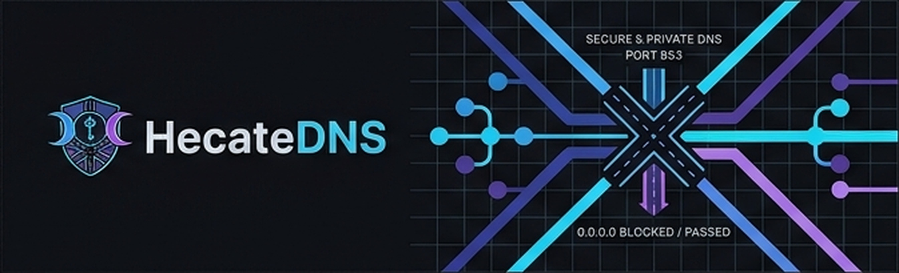

<p align="center">
  
</p>

<p align="center">
  <b>A personal DNS server that blocks browser ads, with no VPN app and no forced SafeSearch.</b>
</p>

<p align="center">
  <a href="https://github.com/shiinobu/hecatedns/actions/workflows/ci.yml"></a>
  <a href="LICENSE"></a>
  
</p>

---

HecateDNS answers DNS queries for your phone or computer and drops the ones that lead to ads, pop-ups, click-redirects and trackers. Everything else is forwarded over an encrypted upstream (DNS-over-HTTPS). It is written in Go and ships as a single binary.

## Features

- **Large block lists.** Loads the HaGeZi and ABPindo lists, about 250,000 domains, and refreshes them on demand.
- **Catches cloaked trackers.** Follows CNAME chains, so a harmless-looking name that points at a tracker is blocked too.
- **Your own rules.** Block or allow any domain and its subdomains; allow always beats block. Rule and list changes apply within seconds, with no restart.
- **Encrypted upstreams.** Queries leave over DNS-over-HTTPS.
- **Safe by default.** A client ACL answers REFUSED to outsiders, and the server forwards queries instead of failing if the filter has a problem.
- **Readable query log.** See what was blocked and what passed, with the reason.
- **DNS-over-TLS for a phone anywhere.** The `native` backend can serve DoT on port 853 so Android's Private DNS works on mobile data; clients are identified by a secret server name, with connection limits and deadlines (see below).
- **A small web dashboard.** An optional separate process shows the status and the query log, blocks or allows a domain with one tap, runs fixed operations (health, backup, certificate renewal) and rotates the DoT name, all from the phone (see below).
- **Two interchangeable backends, one engine.** Switch with a single config line (see below).

## How well does it work?

In a real-phone test on home Wi-Fi, HecateDNS blocked 95 to 97% of a public ad-test page. Over DNS-over-TLS from a VPS the same page scored 95% on mobile data and 97% on Wi-Fi; the small gap on mobile data is not explained yet.

DNS has limits. It cannot block ads served from a site's own domain, redirect scripts hosted on the site itself, or the empty boxes left behind. For the rest, pair it with a browser blocker such as uBlock Origin on Firefox. The research behind this is in [docs/research.md](docs/research.md).

## Two backends, one engine

One shared filter engine runs under two servers. Pick one with `backend:` in the config:

| Backend | What it is |
|---|---|
| `dnsproxy` | A thin adapter around [AdGuard dnsproxy](https://github.com/AdguardTeam/dnsproxy). |
| `native` | An own server, cache, rate limiter and upstream pool built on [`miekg/dns`](https://github.com/miekg/dns). |

Both pass the same conformance suite and make identical decisions.

## Quick start

You need Go 1.26 or newer.

```
go build -o bin/hecate ./cmd/hecate
cp configs/hecate.example.yaml hecate.yaml

./bin/hecate check -config hecate.yaml          # validate the config, run the self-check
./bin/hecate lists update -config hecate.yaml   # download the block lists
./bin/hecate run -config hecate.yaml            # serve on 127.0.0.1:5300
```

Test a query from another terminal:

```
dig @127.0.0.1 -p 5300 example.com
```

On Windows, use `bin\hecate.exe`, and `scripts\windows\dnsquery.ps1 example.com -Port 5300` instead of `dig` (Windows `nslookup` ignores `-port`).

The example config listens on port 5300 so it never clashes with a system resolver. Keys you leave out use defaults; unknown or duplicate keys are rejected with a clear error.

## DNS-over-TLS on a VPS

`configs/hecate.vps.example.yaml` serves only DoT (`backend: native`, no plain DNS). Clients are identified by a long random host name under a wildcard certificate (`dot.names`); a handshake for any other name is refused before a single DNS message is read. `hecate check` loads the certificate and warns about weak names. Android: Settings, Network, Private DNS, then the host name.

The files in `deploy/` (systemd units, certificate renewal, nftables rules, backup script) ran on a real Ubuntu 24.04 VPS on 2026-10-20 and brought up DoT, a Let's Encrypt wildcard certificate and the firewall; the first run found one firewall defect, which is fixed. A real certificate renewal and the seven-day stability run have not been seen yet (see [testing.md](docs/testing.md)). The step-by-step guide, including how to load the firewall without locking yourself out, is in [operations.md](docs/operations.md); the design is in [architecture.md](docs/architecture.md), section 13.1.

## Dashboard

`hecate dashboard` serves one page with five screens: Status, Queries (Block and Allow with Undo), Rules, Connection (a network test, Rotate and Remove old for the DoT name) and Control (health report, backup, certificate renewal test and renewal). It is a separate process with its own unit, reached by a secret host name under the wildcard certificate plus an access key; only the key's hash is stored on the server. It never runs a command itself: Control drops a request file that a root-owned systemd path unit turns into one of five fixed actions. A rotated name is kept only if the server serves it and the public DNS answers lead to this server (a proxied wildcard DNS record would not). `scripts/make-bundle.sh` builds the install bundle, and [operations.md](docs/operations.md) (sections 9 and 10) covers the install, an update, and what to do when the phone cannot open it. The design and the threat model are in [architecture.md](docs/architecture.md), section 18.

## Commands

| Command | What it does |
|---|---|
| `hecate run` | Start the server. |
| `hecate check` | Validate the config, run the self-check, and load the DoT certificate when DoT is on. |
| `hecate log -since 10m -blocked` | Show recent queries; filter by time or only blocked ones. |
| `hecate rule add block example.com` | Block a domain and its subdomains. |
| `hecate rule add allow ok.example.com` | Allow a domain (allow beats block). |
| `hecate rule list` / `hecate rule remove example.com` | Show or remove rules. |
| `hecate lists status` / `hecate lists update` | Show the list cache or re-download the lists. |
| `hecate probe -name-file name.txt` | From any machine, check whether the DoT name resolves, the TLS handshake works and a query is answered, and name the likely cause. `-watch 30s` repeats it. |
| `hecate dashboard` | Serve the web dashboard (needs a `dashboard:` section in the config). |
| `hecate dashboard genkey` / `hecate dashboard hashkey` | Make a new access key and its hash, or hash a key read from stdin. |

Every command takes `-config hecate.yaml`.

## Project layout

```
cmd/hecate/          entry point
backend/controller/  CLI commands
backend/core/        backend contract, dnsproxy adapter, native server
backend/dashboard/   the web dashboard server, login, API, rotation checks
backend/engine/      the filter: ACL, rules, matcher, CNAME check
backend/service/     lists, query log, rule edits, fixed operations, self-check
backend/lib/         config, certificate store, DoT names file, operational log
backend/test/        conformance suite and source-rule gates
frontend/            the dashboard page (HTML, CSS, JavaScript, icons)
configs/             example configurations (home, VPS with DoT and dashboard)
deploy/              Linux files for a VPS (systemd, nftables, renewal, backup, operations wrapper, installers)
scripts/             make-bundle.sh (install bundle); windows/: Task Scheduler autostart, DNS query helper
docs/                architecture, research, testing, operations
```

## Documentation

| Document | Contents |
|---|---|
| [architecture.md](docs/architecture.md) | Design, decisions and security |
| [operations.md](docs/operations.md) | Running it, autostart, deployment, the dashboard, troubleshooting |
| [testing.md](docs/testing.md) | Automated tests and real-phone results |
| [research.md](docs/research.md) | The research behind the design, with sources |

## Development

```
gofmt -l .
go vet ./...
go test ./... -cover
CGO_ENABLED=1 go test -race ./...
```

Source files carry no comments, enforced by a test in `backend/test/nocomment`; the reasoning lives in [docs/](docs/).

## License

[MIT](LICENSE). The block lists HecateDNS downloads (HaGeZi, ABPindo) have their own licenses and are not part of this repository.
